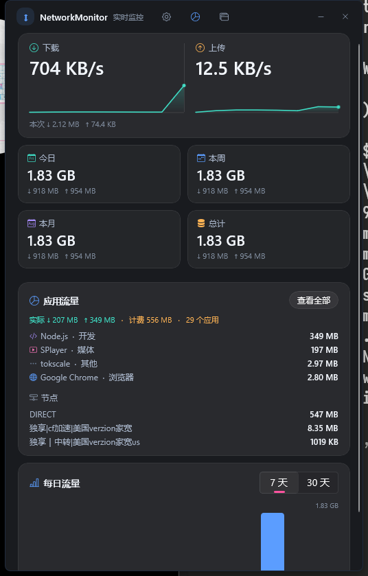
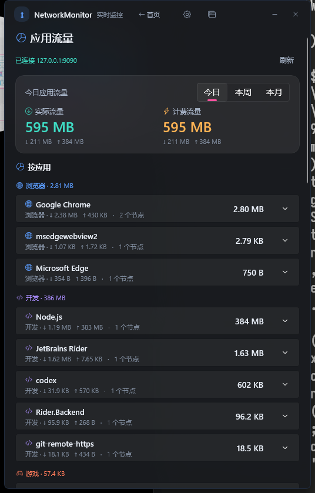
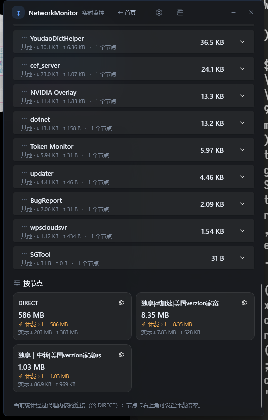

# NetworkMonitor

Windows 网速与流量监控，常驻托盘 / 悬浮窗 / 任务栏。



## 功能

- 实时下载 / 上传速率，1 秒采样 + EMA 平滑，附最近 120 秒曲线
- **今日 / 本周 / 本月 / 总计** 流量，上下行分开统计；7 天 / 30 天柱状图
- **应用流量（FlClash / Clash Verge Rev）**：独立页面 + 首页简要卡片（Top 应用 / Top 节点），按应用 + 节点统计实际/计费流量，支持今日/本周/本月、分类饼图与节点倍率
- **进程流量（全系统，不需要 FlClash）**：基于内核 ETW `Microsoft-Windows-Kernel-Network` 实时会话，按进程统计真实收发字节，支持今日/本周/本月、分类饼图与采集开关
- **独立设置页**：显示、系统、刷新速度、网卡、控制器、版本更新集中在一页
- **刷新速度**：1 / 2 / 5 秒可选，作用于网速、应用流量和界面刷新
- 系统托盘常驻：左键打开主界面，右键菜单切换悬浮窗 / 任务栏条 / 开机自启
- 桌面悬浮小窗：可拖动，双击打开主界面
- 任务栏网速条：贴在通知区域左侧，原生 layered window，只画文字、完全透明无背景
- 亚克力背景 + 圆角卡片，设置面板用 CommunityToolkit 的 `SettingsCard`
- 开机自启（`HKCU\...\Run`，不需要管理员权限；后台服务由 SCM 自启，注册时需要一次管理员权限）

## 应用流量（FlClash / Clash Verge Rev）



节点按两列卡片展示，右上角齿轮可设置倍率：



> 截图为本机实际数据（FlClash TUN 模式，包含 DIRECT 规则）。

首页保留一个简要的 Top 应用卡片；点「查看全部」或左侧导航栏的「应用流量」进入独立页面。

数据来自 Clash/Mihomo 的 **external controller**：

1. FlClash → 设置 → 常规 → 打开 **External controller**（默认 `127.0.0.1:9090`）
   Clash Verge Rev → 设置 → 打开 **External controller**（默认 `127.0.0.1:9097`）
2. 程序会自动读取 FlClash 的 `config.yaml` / `shared_preferences.json`，以及 Clash Verge Rev 的 `config.yaml` / `clash-verge.yaml`，再探测默认端口 9090 / 9097 / 9679，逐个验证、跳过残留的失效配置
3. 标题栏点 `▤`，或启动参数 `--traffic`，打开应用流量页

统计口径：

- 每秒轮询 `/connections`，按连接累计字节的增量归到「进程 + `chains[0]` 节点」
- 进程会映射成友好名称和分类（浏览器 / 开发 / 游戏 / 社交 / 媒体 / 下载 / AI / 系统 / 其他），列表按分类分组
- 应用流量页顶部有分类占比环形图，颜色和分类图标一致
- **节点倍率**：只在「应用流量」页的节点卡右上角齿轮设置（0–100，支持 1x/1.5x/2x/3x/5x）；首页节点摘要只读显示，不提供设置入口。界面同时显示「实际流量」和「计费流量 = 实际 × 倍率」，应用行和汇总也会带计费值。倍率只作用于展示/汇总，数据库里始终存实际字节，改倍率会立即重算历史
- `chains[0]` 就是实际出口节点；`DIRECT` 规则也会记为 `DIRECT`
- 数据按分钟写入 SQLite 的 `proxy_usage` 表，今日/本周/本月从台账聚合
- **只统计经过 FlClash 的连接**。完全不经过代理的直连流量不会出现在这里；要看全系统的真实流量请用「进程流量」页（它基于内核 ETW，不需要代理在运行）

## 进程流量（全系统，不需要 FlClash）

标题栏的进程图标按钮，或启动参数 `--process`，打开「进程流量」页。这一页不依赖 FlClash，也不需要任何代理在运行。

- 数据源：实时 ETW 会话 `NetworkMonitor-ProcessTraffic` 订阅 `Microsoft-Windows-Kernel-Network`（provider `7dd42a49-5329-4832-8dfd-43d979153a88`）。内核在每次 TCP/UDP 收发时把 PID、字节数、远端地址写进事件，所以能覆盖**所有进程的所有连接**，包括直连和走 TUN 的流量
- 事件 ID 10–17（分别对应 IPv4/IPv6 的 TCP 与 UDP），**偶数=发送、奇数=接收**；发送事件的 `daddr` 是远端，接收事件的 `saddr` 是远端
- 负载按「长度定地址族」解析：字段顺序固定为 `PID, size, daddr, saddr, dport, sport`，后面可能再跟 TCP 的 `seqnum, connid` 等字段，所以实测长度有 20 / 28 / 36 / 44 / 52 多种。规则是 `>= 20` 视为 IPv4、`>= 44` 视为 IPv6，只读固定前缀、忽略尾部字段。`daddr` 始终是对端、`saddr` 始终是本机套接字（收发两个方向都一样）。地址按网络字节序直接读原始字节，**不做 TDH `TRACE_EVENT_INFO` 解析**——那套结构的字段偏移在不同 SDK 头文件里互相对不上。首次见到每种事件 ID 时会往日志写一条解码样例（`process: 事件样例 ...`），便于核对格式
- 启动时会自检 `EVENT_TRACE_LOGFILEW == 448`、`EVENT_RECORD == 112`、`EVENT_TRACE_PROPERTIES == 120`，布局不符会直接报错而不是静默错读
- 默认排除回环（127/8、::1）、局域网（10/8、172.16/12、192.168/16）、链路本地（169.254/16、fe80::/10）和多播/广播，避免本机进程互访把台账刷爆
- 按分钟写入 SQLite 的 `process_usage` 表，今日/本周/本月从台账聚合；进程名带启动时间戳做缓存，PID 复用时会重新解析
- 页面右上角「采集 / 已暂停」开关写回 `settings.json` 的 `processTrafficEnabled`；服务每 30 秒重试启动会话，所以启动失败也会自动恢复
- **需要管理员权限**（ETW 实时会话要求）。后台服务以 LocalSystem 运行时天然满足；便携模式前台启动 `NetworkMonitor.Service.exe` 要用管理员身份，否则页面会提示「启动 ETW 会话需要管理员权限」

## 数据口径

- 计数器来自 `GetIfTable2` 的 `MIB_IF_ROW2`（**64 位** `InOctets` / `OutOctets`），不是 32 位的 `GetIPv4Statistics`
- 每秒采样，按分钟写入 SQLite；`今日/本周/本月` 按本地时区聚合（周一为周首日）
- 默认统计所有 Up 的**物理、非隧道**网卡，排除 VPN / 回环 / WFP 过滤层，避免双重计数；可在界面里手动指定网卡
- 已处理：网卡禁用重启用导致计数器归零（丢弃该区间）、休眠唤醒时间跳变、Wi-Fi/有线切换
- **总计从第一次运行开始累计**，不是 Windows「数据使用量」的历史数据

## 后台服务（前后端分离）

v1.2.0 起，采样、SQLite 台账、Clash 轮询都跑在独立的 Windows 服务里，WinUI 只是前端：

```text
NetworkMonitor.Service.exe   (LocalSystem，由 SCM 开机自启)
  GetIfTable2 采样           -> minute_usage
  Clash /connections 轮询     -> proxy_usage
  Kestrel 127.0.0.1:7788 + token
              ^ HTTP
NetworkMonitor.exe           (托盘 / 悬浮窗 / 任务栏条 / 设置，只调 API)
```

- 关掉界面也在统计：注销、未登录、界面未启动都不影响台账
- 注册一次需要管理员权限：设置 → 后台统计服务 → 安装 / 启动（会弹 UAC）；也可以直接
  `NetworkMonitor.Service.exe --install`（`--uninstall` 卸载、`--status` 看状态）
- 之后由 SCM 自动启动；托盘界面仍然是原来的 `HKCU\...\Run` + `--minimized`
- 鉴权：`%ProgramData%\NetworkMonitor\service.token`（首次运行生成，服务和界面自动读取），请求头 `X-NetworkMonitor-Token`；Kestrel 只绑 `127.0.0.1`，浏览器跨站请求也过不了自定义头预检
- 端口默认 `7788`，可用 `NETWORKMONITOR_SERVICE_PORT` 覆盖
- 数据目录迁到 `%ProgramData%\NetworkMonitor`（服务账号是 LocalSystem，用不了用户级 APPDATA）；首次启动会自动复制旧 `%APPDATA%\NetworkMonitor` 里的 db 和 settings，旧目录保留不动
- `settings.json` 仍由界面单写，服务只读，避免两个进程互相覆盖；界面上的网卡/刷新间隔/代理/倍率改动通过 API 推给服务
- API（全部需要 token）：`GET /api/health`、`GET /api/live`（速率 + 网卡 + 选中项 + Clash 快照 + 倍率 + 进程流量快照）、`GET /api/usage`、`GET /api/proxy/report?scope=Today|Week|Month`、`GET /api/process/report?scope=Today|Week|Month`、`POST /api/interfaces/select|auto`、`POST /api/refresh-interval`、`POST /api/proxy/config|refresh|multiplier`、`POST /api/process/enabled`
- 服务以 LocalSystem 运行，直接用 ETW `Microsoft-Windows-Kernel-Network` 做全系统按进程统计（见上面「进程流量」一节）；「应用流量」页仍只覆盖经过 Clash 的连接

## 技术栈

| 层 | 选型 |
|---|---|
| UI | .NET 10 + WinUI 3 / Windows App SDK 1.8（非打包） |
| 后台服务 | .NET 10 Worker + Kestrel，Windows 服务（LocalSystem），只监听 `127.0.0.1` |
| 控件 | [CommunityToolkit.WinUI.Controls](https://github.com/CommunityToolkit/Windows)（Segmented / SettingsCard） |
| 托盘 | [H.NotifyIcon.WinUI](https://github.com/HavenDV/H.NotifyIcon) |
| 存储 | Microsoft.Data.Sqlite（WAL 模式，分钟粒度台账） |
| 图标 | `tools/make_icon.py` 程序化生成多尺寸 ico |

## 界面实现要点

- 主窗口保留 DWM 边框/圆角/阴影，但去掉系统标题栏（`SetBorderAndTitleBar(true, false)`），最小化/关闭用自绘按钮；最大化禁用（移除 `WS_MAXIMIZEBOX` + 拦 `SC_MAXIMIZE` / 标题栏双击），但窗口可以拖 DWM 边缘缩放，最小 420×560 DIP；位置和尺寸（DIP）记在 `settings.json` 的 `MainLeft/MainTop/MainWidth/MainHeight`，恢复时会夹到当前显示器工作区内。**不要**再把 `WM_GETMINMAXINFO` 的 `MaxTrackSize` 设成「当前窗口尺寸」——`SetWindowPos` 会遵守它，启动时一旦比 `ResizeClient` 先到，窗口就会被锁死在系统最小尺寸（就是那个 160×39、只能看到半个标题栏的小窗），而且缩不回去；现在最小/最大尺寸按固定最小值和显示器工作区计算
- 悬浮窗、任务栏条是**无边框窗口**。WinUI 的 `SetBorderAndTitleBar(false, false)` 会残留 `WS_DLGFRAME`，在深色桌面上表现为一圈白边；启动后清掉 `WS_CAPTION | WS_DLGFRAME | WS_THICKFRAME | WS_BORDER | WS_SYSMENU` 等 frame 位并发送 `SWP_FRAMECHANGED`，白边即消失
- **任务栏条优先停靠**：`SetParent(Shell_TrayWnd)` + `WS_CHILD`，位置相对任务栏客户区计算，跟随任务栏移动/DPI/自动隐藏；挂载失败才回退到顶层覆盖窗口
- 停靠后是子窗口，拿不到 DWM 亚克力，所以定位后采样任务栏的实际像素颜色并画同色背景，视觉上等于没有背景（主窗口和悬浮窗仍然保留亚克力）
- Explorer 重启会让父任务栏和子窗口一起销毁，此时**不能对旧 WinUI Window 调 `Close()`**（会崩 coreclr），而是丢弃旧对象、重建窗口再挂载
- 卡片圆角 14、统计卡 12；首页 / 应用流量 / 进程流量 / 设置是四个页面，用左侧导航栏切换（默认展开 104px，点底部折叠按钮可收成 56px 图标条，状态写入 `settings.json` 的 `navCollapsed`），节点用两列卡片网格展示
- 图标使用 Bootstrap Icons（MIT）SVG，分类带独立颜色；实际流量用青色、计费流量用琥珀色，关键数字一眼可区分
- 网卡选择与统计信息已移入设置面板，首页底部只保留功能内容

## 项目结构

```
src/NetworkMonitor.Core/     采样、台账、统计（无 UI 依赖）
  Proxy/                    Clash API 客户端、按进程/节点聚合、proxy_usage 台账
  Service/                  服务端点/令牌、API 契约、RemoteBackend（HTTP 客户端）
src/NetworkMonitor.Service/ Windows 服务宿主：采样 + 台账 + Clash 轮询 + 本地 HTTP API
src/NetworkMonitor.WinUI/    WinUI 3 界面、托盘、悬浮窗、任务栏条（只吃 API）
src/NetworkMonitor.Console/  命令行对账工具（与系统计数器比对用）
installer/NetworkMonitor.iss 安装包（UI + 服务 exe，需管理员权限）
tools/make_icon.py     生成 Assets/networkmonitor.ico
docs/screenshot.png
```

## 构建与运行

```powershell
dotnet build NetworkMonitor.slnx -c Release -p:Platform=x64

# 1) 后台服务（开发时前台跑，日志直接输出）
.\src\NetworkMonitor.Service\bin\Release\net10.0-windows\NetworkMonitor.Service.exe

# 2) 界面
.\src\NetworkMonitor.WinUI\bin\x64\Release\net10.0-windows10.0.26100.0\win-x64\NetworkMonitor.exe
```

`--minimized` 参数可只启动托盘（开机自启项用的就是这个）。界面连不上服务时标题栏会显示「后台服务未连接」，在「设置 → 后台统计服务」里点「安装 / 启动」即可（弹 UAC），或手动以管理员运行：

```powershell
.\src\NetworkMonitor.Service\bin\Release\net10.0-windows\NetworkMonitor.Service.exe --install
```

WinUI 非打包运行需要机器上装有 **Windows App Runtime 1.8**。要发给没装运行时的机器，两个项目都自包含发布到同一目录（服务与界面共用运行时）：

```powershell
dotnet publish src/NetworkMonitor.WinUI -c Release -p:Platform=x64 -r win-x64 `
  -p:WindowsAppSDKSelfContained=true -p:SelfContained=true -o dist

dotnet publish src/NetworkMonitor.Service -c Release -r win-x64 `
  --self-contained true -o dist
```

### 对账工具

```powershell
.\src\NetworkMonitor.Console\bin\Release\net10.0-windows\NetworkMonitor.Console.exe --seconds 15
```

会打印所有网卡、选中网卡、实时速率和台账汇总。开发时用下面的命令对比同一时间窗的增量，验证 P/Invoke 布局与统计口径：

```powershell
Get-NetAdapterStatistics | Select-Object Name, ReceivedBytes, SentBytes
```

## 版本、CI 与自动更新

当前版本 **1.5.0**，显示在「设置 → 版本」。

### CI

- `.github/workflows/build.yml`：push / PR 构建验证
- `.github/workflows/release.yml`：推送 `v*` tag（或手动触发）自动发布

发布流程会：

1. `dotnet publish` 自包含 `win-x64`（含 Windows App SDK，用户无需装运行时）
2. 再发布同样自包含的 `NetworkMonitor.Service.exe` 到同一目录（服务与 UI 共用运行时，避免重复几十 MB）
3. 用 Inno Setup 生成安装包 `NetworkMonitor-Setup-<version>.exe`（安装到 `%LOCALAPPDATA%\Programs\NetworkMonitor`；因为要注册 LocalSystem 后台服务，安装程序需要管理员权限，升级时会先停服务再替换文件）
4. 生成便携版 `NetworkMonitor-<version>-win-x64.zip`
5. 生成文件清单 `manifest-<version>.json`（每个文件的相对路径、大小、SHA256）
6. 用最近 2 个旧版本的清单生成增量包 `NetworkMonitor-patch-<old>-to-<new>.zip`，只包含变化的文件
7. 创建 GitHub Release，附上安装包、zip、清单和增量包，并自动生成 release notes

仓库地址已配置为 `https://github.com/TypeDreamMoon/NetworkMonitor`。CI 会把 `RepositoryUrl` 覆盖成当前仓库。发布命令：

```powershell
git tag v1.5.0
git push origin v1.5.0
```

### 自动更新

- 设置 → 版本 → 检查更新；「自动检查更新」默认开启
- 读取 GitHub 最新 release，优先使用与当前版本对应的增量包 `NetworkMonitor-patch-<当前版本>-to-<新版本>.zip`
- 增量包只包含变化的文件：自包含发布的七百多个文件里，通常只有十来个 `NetworkMonitor*.dll/exe/pdb/deps.json` 会变，所以补丁约 1~2 MB，而完整安装包约 70 MB
- 增量包会校验 SHA256、逐文件复核，并在替换前备份到临时目录，任何一个文件校验失败都会自动回滚
- 如果当前版本没有对应补丁（例如跳过了中间版本），自动回退到完整安装包，对用户表现为「改为下载完整安装包」
- 选择「稍后」会记住跳过的版本，自动检查不再弹窗；手动检查仍会提示
- 本地构建如果还是 `OWNER` 占位，会显示「未配置更新仓库（RepositoryUrl）」
- 自动更新针对安装版；便携版会提示从 Releases 手动下载新的 zip
- 替换 `Program Files` 下的服务文件需要管理员权限，增量更新会弹出一次 UAC；取消提权则更新放弃

## 数据位置

`%ProgramData%\NetworkMonitor\`（便携模式或 `NETWORKMONITOR_HOME` 除外）

- `networkmonitor.db` — 分钟级流量台账（自首次运行起长期保留，一年约 15 MB）
- `settings.json` — 界面与网卡选择
- `service.token` — 本地 API 令牌
- `networkmonitor.log` — 异常日志

便携模式：exe 同目录放一个 `portable.txt`，或设置环境变量 `NETWORKMONITOR_HOME`。便携运行时没有 SCM 服务，需要手动前台启动 `NetworkMonitor.Service.exe`（两个 exe 放在同一目录、共享同一个 `portable.txt` / `NETWORKMONITOR_HOME`），界面才有数据。

## 已知限制 / 后续可做

- 任务栏条没有官方 API，默认是**停靠子窗口**（仅主任务栏、横向任务栏）；竖排/挂载失败时回退为顶层覆盖窗口
- 停靠模式没有亚克力（DWM 系统背景不作用于子窗口），背景用任务栏主题色近似
- 任务栏条不检测全屏应用（停靠模式下任务栏本身会随全屏隐藏；回退覆盖模式仍可能盖在全屏窗口上）
- Win11 默认把新托盘图标放进溢出区，需要用户在任务栏设置里固定
- 总计只覆盖 NetworkMonitor 服务运行期间。若要补系统级历史，可接 WinRT `NetworkUsage`（本机未验证）
- 按进程统计已实现（内核 ETW，见上面「进程流量」一节）；残留限制是它需要管理员/LocalSystem 权限，且默认排除回环与局域网，所以只能看到对外网的流量
- 可加：流量包配额提醒、运营商口径（1000 进制）切换、月账单日设置

## License

暂未选择（建议 MIT）。第三方库许可见各自仓库。
